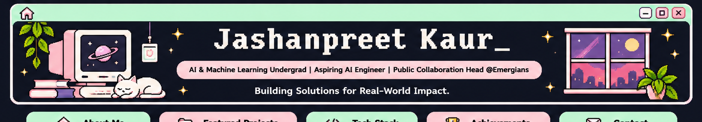
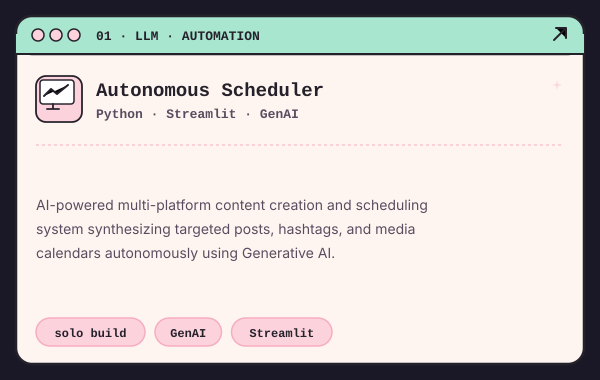
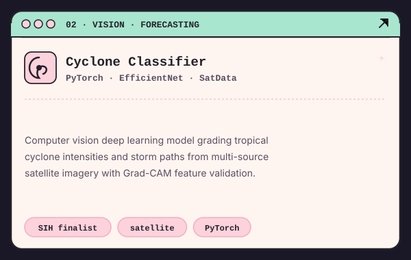
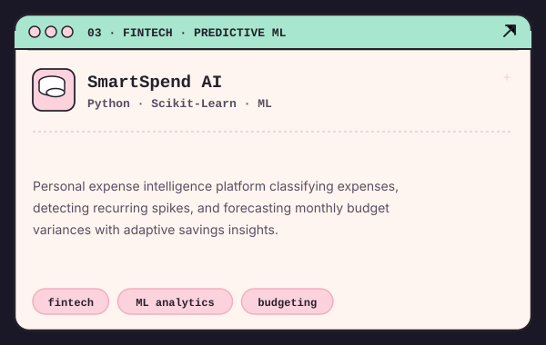
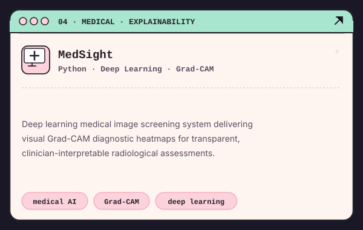
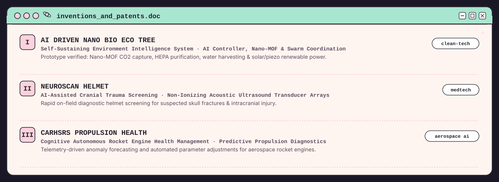
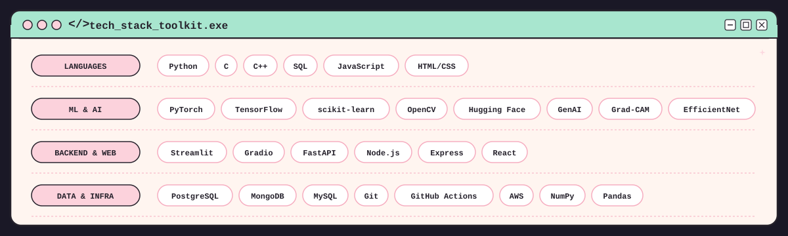
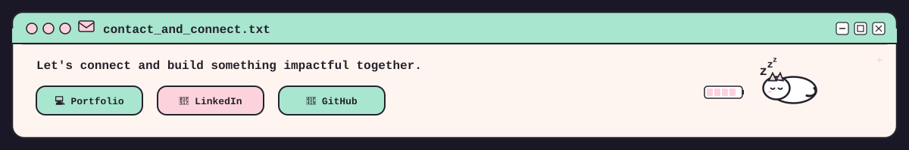

<!-- ═══════════════════════════════════════════════════════════════ -->
<!-- JASHANPREET KAUR — Retro Pixel-Art OS Portfolio               -->
<!-- ═══════════════════════════════════════════════════════════════ -->

  

<!-- Quick Navigation & Social Badges -->

  
  &nbsp;&nbsp;
  

<!-- Stats Overview Banner -->

  

  🎓 <b>B.Tech Artificial Intelligence &amp; Machine Learning</b> · Chandigarh Engineering College, CGC Landran · 2024–2028

 

<!-- ━━━ § 01 SELECTED BUILDS ━━━━━━━━━━━━━━━━━━━━━━━━━━━━━━━━━━━ -->

  

  
  &nbsp;
  

  
  &nbsp;
  

 

<!-- ━━━ § 02 INVENTIONS & PATENTS ━━━━━━━━━━━━━━━━━━━━━━━━━━━━━━ -->

  

  

 

<!-- ━━━ § 03 RECOGNITION & HONOURS ━━━━━━━━━━━━━━━━━━━━━━━━━━━━━ -->

  

  

 

<!-- ━━━ § 04 TOOLKIT & TECHNOLOGIES ━━━━━━━━━━━━━━━━━━━━━━━━━━━━ -->

  

  

 

<!-- ━━━ § 05 CONTACT & CONNECT ━━━━━━━━━━━━━━━━━━━━━━━━━━━━━━━━━ -->

  

