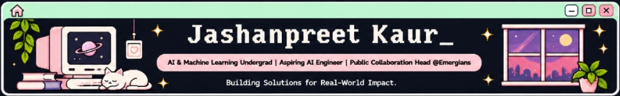
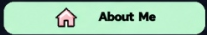
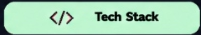
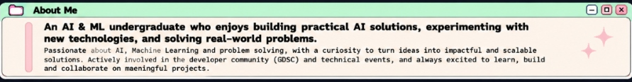
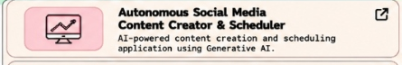
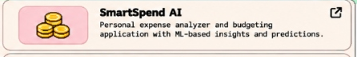
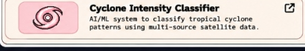
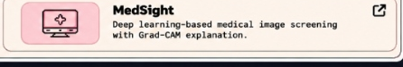
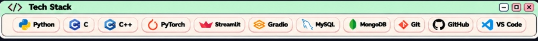
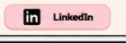

  

  &nbsp;
  &nbsp;
  &nbsp;
  

  

<table width="100%" border="0" cellpadding="0" cellspacing="0">
  <tr>
    <td colspan="2">
      
    </td>
  </tr>
  <tr>
    <td width="50%">
      
    </td>
    <td width="50%">
      
    </td>
  </tr>
  <tr>
    <td width="50%">
      
    </td>
    <td width="50%">
      
    </td>
  </tr>
</table>

  

<table width="100%" border="0" cellpadding="0" cellspacing="0">
  <tr>
    <td colspan="5">
      
    </td>
  </tr>
  <tr>
    <td width="41%">
      
    </td>
    <td width="15.4%">
      
    </td>
    <td width="15.7%">
      
    </td>
    <td width="13.2%">
      
    </td>
    <td width="14.7%">
      
    </td>
  </tr>
</table>

 

<b>📂 Click to expand: Inventions, Leadership &amp; Recognitions</b>

 

### § 01 — Inventions &amp; Research Concepts

*Exploring technology beyond conventional software applications.*

| Project / Concept | Focus &amp; Description | Status |
|:---|:---|:---|
| **NeuroScan Helmet** | AI-assisted helmet concept for rapid screening of suspected skull fractures using non-ionizing ultrasound sensing. | `Innovation concept` · `Patent exploration` |
| **CARHSRS** | Cognitive Autonomous Rocket Engine Health Management system predicting engine anomalies and parameter adjustments. | `Research concept` · `Autonomous Systems` |

---

### § 02 — Recognitions &amp; Milestones

| Recognition | Details / Organization |
|:---|:---|
| **SheFi Scholar** | Season 16 Scholar |
| **AWS Certification** | Cloud Practitioner / Certified |
| **Smart India Hackathon** | National Finalist / Participant |
| **Technical Hackathons** | Multiple AI/ML hackathons participated |
| **Community Leadership** | Event Anchor &amp; Collaboration Lead |

---

### § 03 — Experience &amp; Community

#### Public Collaboration Head — *Emergence Club*
- **GDG Cloud Chandigarh** — Event Anchoring &amp; Speaker Coordination
- **AI Bootcamp 2K26** — Technical Workshop Host &amp; Moderation
- Active technical community builder &amp; open-source contributor

---

### § 04 — Let's Connect

  Interested in AI/ML solutions, research, or hackathon collaborations? 
  <b>Let's build something extraordinary together!</b>

  
  &nbsp;&nbsp;
  

 

  Designed with retro pixel-art aesthetic · © Jashanpreet Kaur

