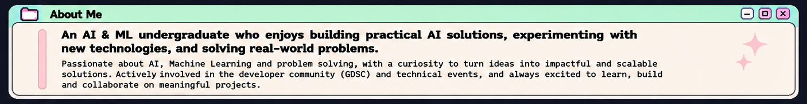
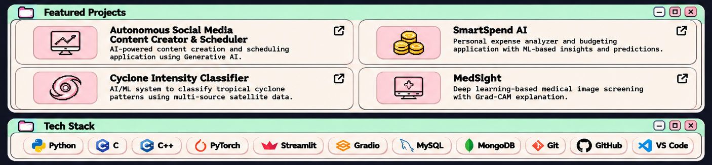
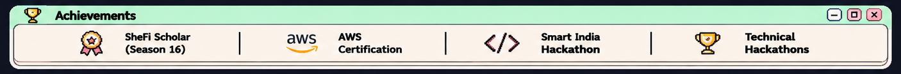

<!-- ━━━ 1. MAIN PROFILE BANNER ━━━━━━━━━━━━━━━━━━━━━━━━━━━━━━━━━ -->

  

<!-- ━━━ 2. ABOUT ME ━━━━━━━━━━━━━━━━━━━━━━━━━━━━━━━━━━━━━━━━━━━━ -->

  

<!-- ━━━ 3. FEATURED PROJECTS ━━━━━━━━━━━━━━━━━━━━━━━━━━━━━━━━━━━ -->

  

<!-- Clickable Project Repository Cards -->
<table width="100%">
  <tr>
    <td width="50%" valign="top">
      <h3>📈 <a href="https://github.com/jashan-26/Autonomous-Social-Media-Content-Creator-Scheduler">Autonomous Social Media Content Creator &amp; Scheduler</a></h3>
      
AI-powered content creation and automated scheduling system using Generative AI.

      <code>Python</code> <code>Streamlit</code> <code>GenAI</code>
    </td>
    <td width="50%" valign="top">
      <h3>💰 <a href="https://github.com/jashan-26/SmartSpend-AI">SmartSpend AI</a></h3>
      
Personal expense analyzer and budgeting application with ML-based predictive insights.

      <code>Python</code> <code>Machine Learning</code>
    </td>
  </tr>
  <tr>
    <td width="50%" valign="top">
      <h3>🌀 <a href="https://github.com/jashan-26/cyclone-intensity-classifier">Cyclone Intensity Classifier</a></h3>
      
AI/ML system to accurately classify tropical cyclone patterns using satellite data.

      <code>Python</code> <code>PyTorch</code> <code>EfficientNet</code>
    </td>
    <td width="50%" valign="top">
      <h3>🩺 <a href="https://github.com/jashan-26/MedSight">MedSight</a></h3>
      
Deep learning medical image screening with Grad-CAM visual interpretability.

      <code>Python</code> <code>Deep Learning</code> <code>Grad-CAM</code>
    </td>
  </tr>
</table>

 

<!-- ━━━ 4. TECH STACK ━━━━━━━━━━━━━━━━━━━━━━━━━━━━━━━━━━━━━━━━━━ -->

  

 

<!-- ━━━ 5. CONTACT ━━━━━━━━━━━━━━━━━━━━━━━━━━━━━━━━━━━━━━━━━━━━━ -->

  

<!-- Clickable Contact Links -->

  
  &nbsp;&nbsp;&nbsp;&nbsp;
  

 

  Designed with retro pixel-art aesthetic · © Jashanpreet Kaur

