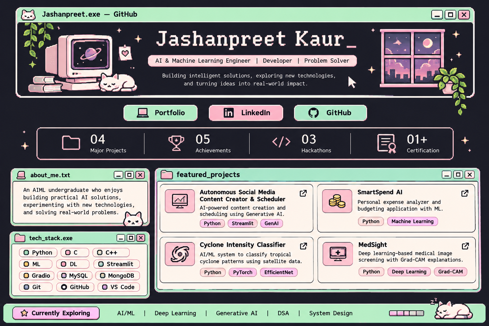

 

  

<h1 align="center">Jashanpreet Kaur <code>_</code></h1>

  <strong>AI & Machine Learning Undergrad | Aspiring Al Engineer | Building Solutions for Real-World Impact</strong>

  Building intelligent solutions, exploring new technologies, 
  and turning ideas into real-world impact.

  
  
  

---

<h3 align="center">✦ A LITTLE ABOUT ME ✦</h3>

  An AI & Machine Learning undergraduate passionate about building practical applications, experimenting with intelligent systems, and solving real-world problems through technology.

  🎓 B.Tech — Artificial Intelligence & Machine Learning 
  💻 Python | C | C++ 
  🧠 Artificial Intelligence | Machine Learning | Generative AI 
  🚀 Learning, building and exploring new possibilities.

---

<h3 align="center">✦ MY DIGITAL DESK ✦</h3>

<table>
<tr>
<td align="center" width="25%">
  <h2>✧</h2>
  <strong>Projects</strong> 
  Building intelligent applications
</td>
<td align="center" width="25%">
  <h2>♡</h2>
  <strong>Achievements</strong> 
  Learning and growing
</td>
<td align="center" width="25%">
  <h2>⌘</h2>
  <strong>Experience</strong> 
  Community and collaboration
</td>
<td align="center" width="25%">
  <h2>✦</h2>
  <strong>Interests</strong> 
  AI and emerging technology
</td>
</tr>
</table>

---

<h3 align="center">✦ SELECTED BUILDS / 04 PROJECTS ✦</h3>

<table>
<tr>
<td width="50%" valign="top">

### 01. Autonomous Social Media Content Creator & Scheduler

An AI-powered web application designed to automate social media content creation and scheduling using Generative AI.

**Technologies**

`Python` `Streamlit` `GenAI`

<a href="https://github.com/jashan-26/Autonomous-Social-Media-Content-Creator-Scheduler">↗ View Repository</a>

</td>
<td width="50%" valign="top">

### 02. SmartSpend AI

An intelligent personal expense management system that tracks daily spending, analyses financial habits, and predicts future expenses.

**Technologies**

`Python` `Machine Learning`

<a href="https://github.com/jashan-26/SmartSpend-AI">↗ View Repository</a>

</td>
</tr>
<tr>
<td width="50%" valign="top">

### 03. Cyclone Intensity Classifier

An AI/ML-based system that uses multi-source satellite data to classify tropical cyclone patterns and support early warning systems.

**Technologies**

`Python` `PyTorch` `EfficientNet-B0`

<a href="https://github.com/jashan-26/cyclone-intensity-classifier">↗ View Repository</a>

</td>
<td width="50%" valign="top">

### 04. MedSight

A deep learning-based medical image screening system that identifies potential abnormalities and visualises relevant regions using Grad-CAM.

**Technologies**

`Python` `Deep Learning` `Grad-CAM`

<a href="https://github.com/jashan-26/MedSight">↗ View Repository</a>

</td>
</tr>
</table>

---

<h3 align="center">✦ TECH STACK / MY TOOLBOX ✦</h3>

**Programming Languages**

**AI / ML & Development**

**Databases & Tools**

---

<h3 align="center">✦ EXPERIENCE & COMMUNITY ✦</h3>

**Public Collaboration Head — Emergence Club**

Contributing to community engagement, collaborations and technical event initiatives.

- GDG Cloud Chandigarh — Event Anchoring
- AI Bootcamp 2K26 — Event Anchoring
- Community coordination and collaboration.

---

<h3 align="center">✦ ACHIEVEMENTS & RECOGNITION ✦</h3>

| Recognition | Details |
|---|---|
| ✧ SheFi Scholar | Season 16 |
| ✧ Smart India Hackathon | Participation |
| ✧ AWS | Certification |
| ✧ Hackathons | Technical event participation |

---

<h3 align="center">✦ CURRENTLY EXPLORING ✦</h3>

  AI / ML &nbsp; ✦ &nbsp; Deep Learning &nbsp; ✦ &nbsp; Generative AI
    
  Data Structures & Algorithms &nbsp; ✦ &nbsp; System Design

---

<h3 align="center">LET'S CONNECT ♡</h3>

  Have an interesting idea or want to collaborate on something?
   
  Let's connect and build something meaningful.

  <a href="https://www.linkedin.com/in/jashanpreet-k-13a326340/">LinkedIn</a>
  &nbsp; ✦ &nbsp;
  <a href="https://github.com/jashan-26">GitHub</a>
  &nbsp; ✦ &nbsp;
  <a href="YOUR_PORTFOLIO_URL">Portfolio</a>

  <i>Made with curiosity, creativity & a little cosmic energy. ✦</i>

