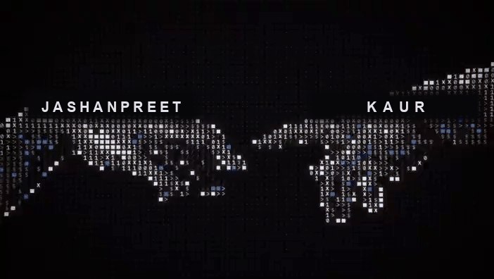

  

<h1 align="center">Heyyy, I'm Jashanpreet ✨</h1>

<h3 align="center">AI &amp; Machine Learning Engineer | Developer</h3>

  

<h2 align="center">🚀 About Me </h2>

So here's the brief 💫 I'm an AI & Machine Learning undergraduate, researcher, and problem solver who loves taking ambitious ideas and turning them into practical, real-world solutions.

I build end-to-end deep learning systems, computer vision pipelines, and patent-filed biomedical and environmental architectures. Whether it's self-sustaining eco-intelligence systems, non-ionizing acoustic cranial trauma screening, or rocket propulsion telemetry diagnostics, I'm always drawn to tough problems at the edge of science and software.

My days basically go: find a challenging problem → design the architecture → train the model → debug the edge cases → optimize until it shines → deploy and iterate.

Aggressively curious, mildly caffeinated, and permanently dedicated to building intelligent technology that actually makes a difference in people's lives. Currently serving as Public Collaboration Head @ Emergians, anchoring developer events, and collaborating on high-impact projects.

 

<h2 align="center">🤝 Connect</h2>

<h2 align="center">💻 Tech Stack</h2>

 &nbsp;
 &nbsp;
 &nbsp;
 &nbsp;
 &nbsp;
 &nbsp;
 &nbsp;

  
 &nbsp;
 &nbsp;
 &nbsp;
 &nbsp;
 &nbsp;
 &nbsp;

  
 &nbsp;
 &nbsp;
 &nbsp;
 &nbsp;

<h2 align="center">📊 GitHub Stats</h2>

  

<h2 align="center">⌘ Commit Activity</h2>

  

<h2 align="center">⌘ Philosophy</h2>

  <em>"Building solutions for real-world impact."</em>
   
  — Jashanpreet Kaur

