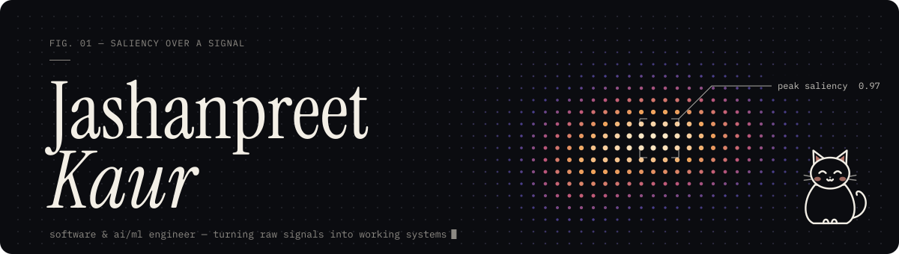
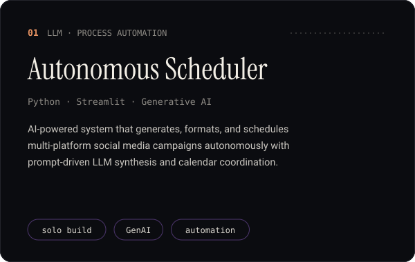
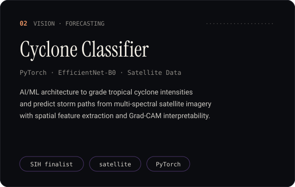
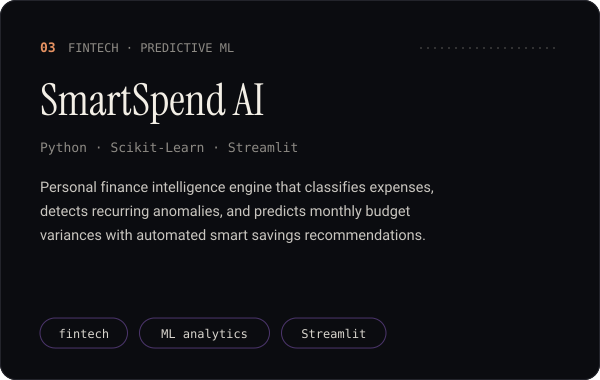
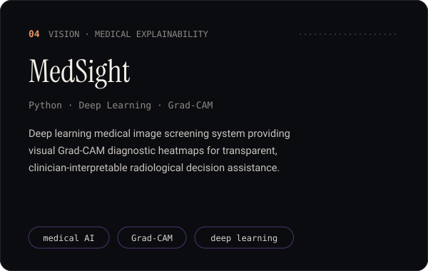
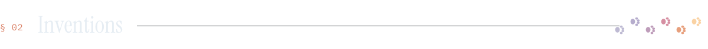
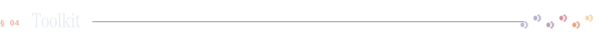
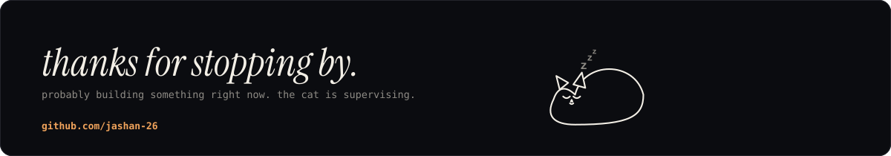

<picture><source media="(prefers-color-scheme: dark)" srcset="./assets/header-dark.svg" /><source media="(prefers-color-scheme: light)" srcset="./assets/header-light.svg" /></picture>

  <a href="https://linkedin.com/in/jashanpreet-k-13a326340/"><picture><source media="(prefers-color-scheme: dark)" srcset="https://img.shields.io/badge/linkedin-jashanpreet--k-f0a35b?style=flat-square&labelColor=0b0c10&logo=linkedin&logoColor=f3efe6" /><source media="(prefers-color-scheme: light)" srcset="https://img.shields.io/badge/linkedin-jashanpreet--k-ee8a3c?style=flat-square&labelColor=16151a&logo=linkedin&logoColor=faf8f3" /></picture></a>
  &nbsp;
  <a href="https://github.com/jashan-26"><picture><source media="(prefers-color-scheme: dark)" srcset="https://img.shields.io/badge/github-jashan--26-f0a35b?style=flat-square&labelColor=0b0c10&logo=github&logoColor=f3efe6" /><source media="(prefers-color-scheme: light)" srcset="https://img.shields.io/badge/github-jashan--26-ee8a3c?style=flat-square&labelColor=16151a&logo=github&logoColor=faf8f3" /></picture></a>

<picture><source media="(prefers-color-scheme: dark)" srcset="./assets/stats-dark.svg" /><source media="(prefers-color-scheme: light)" srcset="./assets/stats-light.svg" /></picture>

  B.Tech Artificial Intelligence & Machine Learning · Chandigarh Engineering College, CGC Landran · 2024–2028

 

<picture><source media="(prefers-color-scheme: dark)" srcset="./assets/s01-dark.svg" /><source media="(prefers-color-scheme: light)" srcset="./assets/s01-light.svg" /></picture>

<a href="https://github.com/jashan-26/Autonomous-Social-Media-Content-Creator-Scheduler"><picture><source media="(prefers-color-scheme: dark)" srcset="./assets/p-social-dark.svg" /><source media="(prefers-color-scheme: light)" srcset="./assets/p-social-light.svg" /></picture></a>
&nbsp;
<a href="https://github.com/jashan-26/cyclone-intensity-classifier"><picture><source media="(prefers-color-scheme: dark)" srcset="./assets/p-cyclone-dark.svg" /><source media="(prefers-color-scheme: light)" srcset="./assets/p-cyclone-light.svg" /></picture></a>

<a href="https://github.com/jashan-26/SmartSpend-AI"><picture><source media="(prefers-color-scheme: dark)" srcset="./assets/p-smartspend-dark.svg" /><source media="(prefers-color-scheme: light)" srcset="./assets/p-smartspend-light.svg" /></picture></a>
&nbsp;
<a href="https://github.com/jashan-26/MedSight"><picture><source media="(prefers-color-scheme: dark)" srcset="./assets/p-medsight-dark.svg" /><source media="(prefers-color-scheme: light)" srcset="./assets/p-medsight-light.svg" /></picture></a>

 

<picture><source media="(prefers-color-scheme: dark)" srcset="./assets/s02-dark.svg" /><source media="(prefers-color-scheme: light)" srcset="./assets/s02-light.svg" /></picture>

<picture><source media="(prefers-color-scheme: dark)" srcset="./assets/patents-dark.svg" /><source media="(prefers-color-scheme: light)" srcset="./assets/patents-light.svg" /></picture>

 

<picture><source media="(prefers-color-scheme: dark)" srcset="./assets/s03-dark.svg" /><source media="(prefers-color-scheme: light)" srcset="./assets/s03-light.svg" /></picture>

<picture><source media="(prefers-color-scheme: dark)" srcset="./assets/recognition-dark.svg" /><source media="(prefers-color-scheme: light)" srcset="./assets/recognition-light.svg" /></picture>

 

<picture><source media="(prefers-color-scheme: dark)" srcset="./assets/s04-dark.svg" /><source media="(prefers-color-scheme: light)" srcset="./assets/s04-light.svg" /></picture>

<picture><source media="(prefers-color-scheme: dark)" srcset="./assets/toolkit-dark.svg" /><source media="(prefers-color-scheme: light)" srcset="./assets/toolkit-light.svg" /></picture>

 

<a href="https://github.com/jashan-26"><picture><source media="(prefers-color-scheme: dark)" srcset="./assets/footer-dark.svg" /><source media="(prefers-color-scheme: light)" srcset="./assets/footer-light.svg" /></picture></a>
