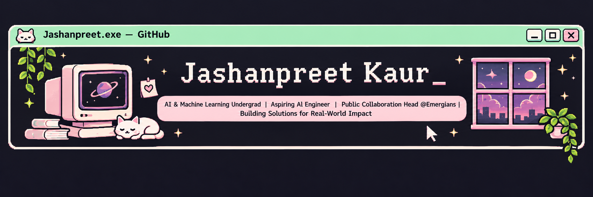

 

  

  
  
  

  <a href="#about-me">About</a> &nbsp;·&nbsp;
  <a href="#featured-projects">Projects</a> &nbsp;·&nbsp;
  <a href="#tech-stack">Tech Stack</a> &nbsp;·&nbsp;
  <a href="#experience">Experience</a> &nbsp;·&nbsp;
  <a href="#achievements">Achievements</a> &nbsp;·&nbsp;
  <a href="#contact">Contact</a>

---

<table width="100%">
<tr>
<td align="center" width="25%">

### 04

**Projects**

</td>
<td align="center" width="25%">

### AI / ML

**Focus Area**

</td>
<td align="center" width="25%">

### Club Head

**Leadership**

</td>
<td align="center" width="25%">

### Scholar

**Recognition**

</td>
</tr>
</table>

  B.Tech Artificial Intelligence & Machine Learning · Chandigarh Engineering College

---

## 01 / About Me

<table>
<tr>
<td width="100%">

### `about_me.txt`

Hey! I'm **Jashanpreet Kaur**, an Artificial Intelligence and Machine Learning undergraduate passionate about building practical AI applications, exploring emerging technologies, and solving real-world problems.

- 🎓 B.Tech in Artificial Intelligence & Machine Learning
- 💻 Programming with Python, C and C++
- 🧠 Exploring AI, Machine Learning and Generative AI
- 🚀 Interested in building intelligent and useful software systems
- ✨ Always learning, experimenting and creating.

</td>
</tr>
</table>

## 02 / Featured Projects

*Selected builds from my development journey.*

<table width="100%">
<tr>
<td width="50%" valign="top">

### 01. Autonomous Social Media Content Creator & Scheduler

An AI-powered application that automates social media content creation and scheduling using Generative AI.

`Python` `Streamlit` `GenAI`

<a href="https://github.com/jashan-26/Autonomous-Social-Media-Content-Creator-Scheduler">↗ Explore Repository</a>

</td>
<td width="50%" valign="top">

### 02. SmartSpend AI

A personal expense analysis and budgeting application that tracks spending, analyses financial habits and predicts future expenses.

`Python` `Machine Learning`

<a href="https://github.com/jashan-26/SmartSpend-AI">↗ Explore Repository</a>

</td>
</tr>
<tr>
<td width="50%" valign="top">

### 03. Cyclone Intensity Classifier

An AI/ML system that uses multi-source satellite data and EfficientNet-B0 to classify tropical cyclone patterns and support early warnings.

`Python` `PyTorch` `EfficientNet-B0`

<a href="https://github.com/jashan-26/cyclone-intensity-classifier">↗ Explore Repository</a>

</td>
<td width="50%" valign="top">

### 04. MedSight

A deep learning-based medical image screening system that identifies potential abnormalities and visualises relevant regions using Grad-CAM.

`Python` `Deep Learning` `Grad-CAM`

<a href="https://github.com/jashan-26/MedSight">↗ Explore Repository</a>

</td>
</tr>
</table>

## 03 / Tech Stack

<table width="100%">
<tr>
<td width="50%" valign="top">

### `tech_stack.exe`

**Programming Languages**

**AI & Machine Learning**

</td>
<td width="50%" valign="top">

### `development_tools.exe`

**Frameworks**

**Databases & Tools**

</td>
</tr>
</table>

## 04 / Experience & Community

<table width="100%">
<tr>
<td>

### Public Collaboration Head

**Emergence Club**

Contributing to public collaborations, community engagement, and technical event initiatives.

**Event involvement**

- GDG Cloud Chandigarh — Event Anchoring
- AI Bootcamp 2K26 — Event Anchoring
- Community coordination and collaboration.

</td>
</tr>
</table>

## 05 / Achievements & Recognition

| Recognition | Details |
|---|---|
| ✦ SheFi Scholar | Season 16 |
| ✦ AWS | Certification |
| ✦ Smart India Hackathon | Participation |
| ✦ Technical Hackathons | Participation |

## 06 / Currently Exploring

  
  
  
  
  

## 07 / Contact

  Interested in technology, collaboration, or building something meaningful?
   
  Let's connect!

  <a href="https://github.com/jashan-26">GitHub</a>
  &nbsp; ✦ &nbsp;
  <a href="https://www.linkedin.com/in/jashanpreet-k-13a326340/">LinkedIn</a>
  &nbsp; ✦ &nbsp;
  <a href="YOUR_PORTFOLIO_URL">Portfolio</a>

  <i>Building ideas, one commit at a time. ♡</i>

  Jashanpreet.exe · End of README · 2026

