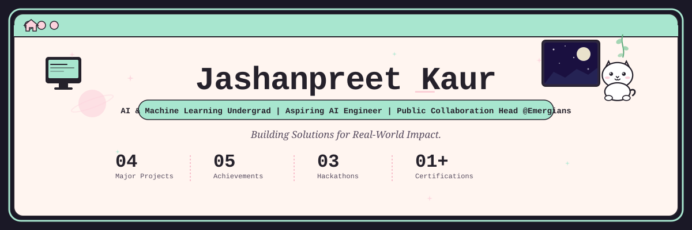
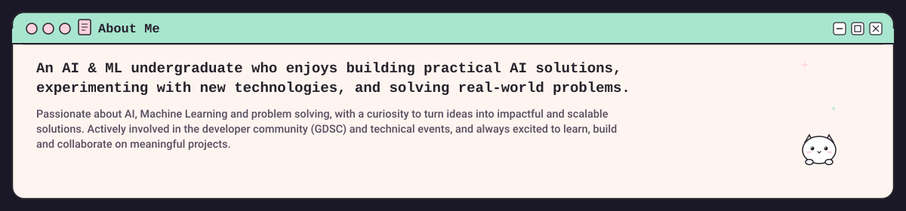
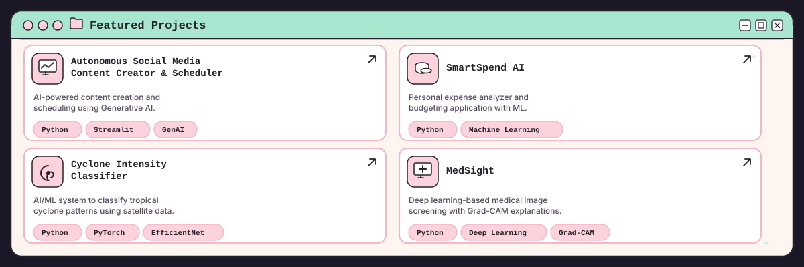
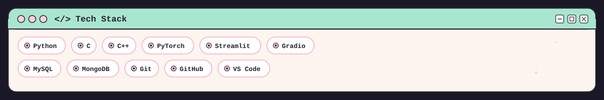
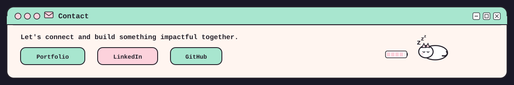

<!-- ═══════════════════════════════════════════════════════════════ -->
<!-- JASHANPREET KAUR — Vertically Scrolling GitHub Portfolio      -->
<!-- Each section has its own wide banner image (3:1+ ratio)       -->
<!-- ═══════════════════════════════════════════════════════════════ -->

<!-- ━━━ 1. MAIN HEADER BANNER ━━━━━━━━━━━━━━━━━━━━━━━━━━━━━━━━━━ -->

  

<!-- Quick Navigation Bar matching reference UI -->

  
  &nbsp;
  
  &nbsp;
  
  &nbsp;
  

 

<!-- ━━━ 2. ABOUT ME BANNER ━━━━━━━━━━━━━━━━━━━━━━━━━━━━━━━━━━━━━ -->

  

<!-- ━━━ 3. ABOUT ME CONTENT (Selectable) ━━━━━━━━━━━━━━━━━━━━━━━ -->

<blockquote>
  

    🎓 <b>AI &amp; ML Undergraduate</b> &nbsp;|&nbsp; 💡 <b>Aspiring AI Engineer</b> &nbsp;|&nbsp; 🌐 <b>Public Collaboration Head @Emergians</b>  
    Passionate about building practical AI solutions, experimenting with generative systems, and turning complex ideas into scalable, real-world impact. Actively involved in developer communities, hackathons, and collaborative engineering.
  

</blockquote>

 

<!-- ━━━ 4. FEATURED PROJECTS BANNER ━━━━━━━━━━━━━━━━━━━━━━━━━━━━ -->

  

<!-- ━━━ 5. FEATURED PROJECTS CONTENT (Clickable Links) ━━━━━━━━━ -->

<table>
  <tr>
    <td width="50%">
      <h3>🔗 <a href="https://github.com/jashan-26/Autonomous-Social-Media-Content-Creator-Scheduler">Autonomous Social Media Content Creator &amp; Scheduler</a></h3>
      
AI-powered content creation and scheduling application using Generative AI.

      <code>Python</code> <code>Streamlit</code> <code>GenAI</code>
    </td>
    <td width="50%">
      <h3>🔗 <a href="https://github.com/jashan-26/SmartSpend-AI">SmartSpend AI</a></h3>
      
Personal expense analyzer and budgeting application with ML-based insights.

      <code>Python</code> <code>Machine Learning</code>
    </td>
  </tr>
  <tr>
    <td width="50%">
      <h3>🔗 <a href="https://github.com/jashan-26/cyclone-intensity-classifier">Cyclone Intensity Classifier</a></h3>
      
AI/ML system to classify tropical cyclone patterns using multi-source satellite data.

      <code>Python</code> <code>PyTorch</code> <code>EfficientNet</code>
    </td>
    <td width="50%">
      <h3>🔗 <a href="https://github.com/jashan-26/MedSight">MedSight</a></h3>
      
Deep learning-based medical image screening with Grad-CAM visual explanations.

      <code>Python</code> <code>Deep Learning</code> <code>Grad-CAM</code>
    </td>
  </tr>
</table>

 

<!-- ━━━ 6. TECH STACK BANNER ━━━━━━━━━━━━━━━━━━━━━━━━━━━━━━━━━━━ -->

  

<!-- ━━━ 7. TECH STACK CONTENT (Selectable) ━━━━━━━━━━━━━━━━━━━━━ -->

  <code>Python</code> &nbsp;
  <code>C</code> &nbsp;
  <code>C++</code> &nbsp;
  <code>PyTorch</code> &nbsp;
  <code>Streamlit</code> &nbsp;
  <code>Gradio</code> &nbsp;
  <code>MySQL</code> &nbsp;
  <code>MongoDB</code> &nbsp;
  <code>Git</code> &nbsp;
  <code>GitHub</code> &nbsp;
  <code>VS Code</code>

 

<!-- ━━━ 8. CONTACT BANNER ━━━━━━━━━━━━━━━━━━━━━━━━━━━━━━━━━━━━━━ -->

  

<!-- ━━━ 9. CONTACT LINKS (Clickable) ━━━━━━━━━━━━━━━━━━━━━━━━━━━ -->

  
  &nbsp;&nbsp;
  

 

<!-- ━━━ EXTRAS (Collapsible) ━━━━━━━━━━━━━━━━━━━━━━━━━━━━━━━━━━━ -->

<b>📂 Click to expand: Inventions, Leadership &amp; Recognitions</b>

 

### § 01 — Inventions &amp; Research Concepts

*Exploring technology beyond conventional software applications.*

| Project / Concept | Focus &amp; Description | Status |
|:---|:---|:---|
| **NeuroScan Helmet** | AI-assisted helmet concept for rapid screening of suspected skull fractures using non-ionizing ultrasound sensing. | `Innovation concept` · `Patent exploration` |
| **CARHSRS** | Cognitive Autonomous Rocket Engine Health Management system predicting engine anomalies and parameter adjustments. | `Research concept` · `Autonomous Systems` |

---

### § 02 — Recognitions &amp; Milestones

| Recognition | Details / Organization |
|:---|:---|
| **SheFi Scholar** | Season 16 Scholar |
| **AWS Certification** | Cloud Practitioner / Certified |
| **Smart India Hackathon** | National Finalist / Participant |
| **Technical Hackathons** | Multiple AI/ML hackathons participated |
| **Community Leadership** | Event Anchor &amp; Collaboration Lead |

---

### § 03 — Experience &amp; Community

#### Public Collaboration Head — *Emergence Club*
- **GDG Cloud Chandigarh** — Event Anchoring &amp; Speaker Coordination
- **AI Bootcamp 2K26** — Technical Workshop Host &amp; Moderation
- Active technical community builder &amp; open-source contributor

 

  Designed with retro pixel-art aesthetic · © Jashanpreet Kaur

